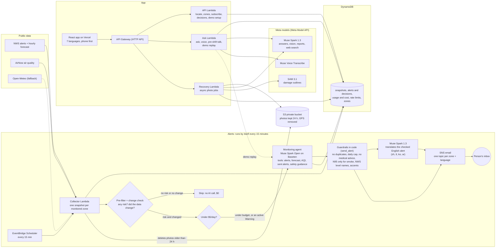

# ClimateGuard

**Free heat, smoke, flood and storm alerts in your own language, and help with the paperwork after a disaster.** Built for farmworkers, outdoor workers and immigrant families in the United States. Stockton, California is the first area.

- **Live app:** https://climate-guard-khaki.vercel.app
- **Demo (no sign-up, no email, no photos of your own needed):** https://climate-guard-khaki.vercel.app/?demo=1
- **Code:** https://github.com/dangkhoa241/ClimateGuard

Built for the Meta Global AI Developer Hackathon (Indie Developer track).

## 60-second judge path

Open the [demo](https://climate-guard-khaki.vercel.app/?demo=1) on your phone. Pick a language at the top if you like.

1. **Replay a real flood.** Tap **Flood · Planada · January 2023**. The real alert agent reads that night's weather data, decides, and writes the alert in your language. It is labeled "REPLAY of a real event", shows the agent's reason and its cost, and sends no email.
2. **Report damage.** Tap **Try with sample photos**, tap a photo, then **Check my photos**. SAM 3.1 outlines the damage. Answer the questions, tap **Make my report**, then **Print or save as PDF**. This step takes about a minute.
3. **Ask a question.** Go back, tap **Ask about Stockton**, tap a sample question. Try the mic, or **Read aloud**.
4. **See how it decides.** The "How it works" strip at the bottom links to the decision history and shows the real AI cost of the live site so far.

## The problem

This project started with a worry close to home. My aunt kept asking whether her daughter, a college student in Los Angeles, had water on hot days, a raincoat when it rained and a jacket when it was windy. Forecast apps give numbers, but she wanted a plain message about what to do. I built a [weather pipeline](https://github.com/dangkhoa241/us-weather-pipeline) for that, and ClimateGuard grew from it: alerts that tell you what to do, in the language you read best, for everyone in the community.

ClimateGuard was built from scratch during the hackathon (Oct 26 to Nov 4, 2026); the earlier project is only where the idea started.

Most official warnings are written in English. Farmworkers and immigrant families can miss them, or get them too late to act.

In **September 2022**, Stockton was under an Excessive Heat Warning from Sept 4 to 9 and tied its all-time record of 115°F on Sept 6. That same day the county air quality index reached 208. In **January 2023**, floods in Merced County forced Planada to evacuate on Jan 10. These are real events, and the demo replays them. After a disaster like this, people also have to prove their damage to an insurer or FEMA, often in a second language.

ClimateGuard does two jobs:
- **Before and during:** it watches official weather and air-quality data and sends a short, plain alert in the person's language, only when there is real danger.
- **After:** the person photographs the damage and gets a report and a document checklist to give to an insurer, FEMA or a helper.

In the demo story, **Maria is an example person**, labeled as one everywhere. The events, places and data are real.

## What it does

- **Monitoring agent.** Every 15 minutes it checks NWS alerts, the forecast and air quality for each area with a confirmed subscriber. A cheap check skips the AI when there is no risk or nothing changed. Otherwise an AI agent decides whether to alert, writes the alert, and every decision is logged with its reason. Alerts go out by email, one topic per area and language.
- **Ask.** Ask by text or voice, in your language. Answers use live data for your area and show their sources. **Read aloud** uses your phone's own voices. Questions about cooling centers and shelters get a cited web search, or a fixed "call 211" fallback.
- **Supervisor view.** A fixed Cal/OSHA (California) or OSHA checklist for today's conditions, plus a short AI pre-shift talk to read aloud or share on WhatsApp.
- **Recovery agent.** Pick a disaster, add 1 to 6 photos. SAM 3.1 outlines the damage, 2 to 4 fixed questions follow, then a report in your language plus English, a fixed checklist, and print-to-PDF.
- **Decision history.** A public page, "How ClimateGuard decides", lists every decision the live agent made, including each time it chose not to alert.
- **Demo mode.** Real past events replayed through the live agent, sample photos, sample area, no email. If the budget is spent, it shows earlier saved real runs, not an error.
- **Languages.** The screens and alerts come in 7 languages. A native Vietnamese speaker reviewed the Vietnamese wording; a Spanish reviewer is still wanted. Chinese, Tagalog, Korean and Arabic are **machine-translated and labeled as such** everywhere. Arabic switches the page to right-to-left.

## Meta tooling

| Tool | What it does here | Why |
|---|---|---|
| **Muse Spark Open** (`muse-spark-open-1026`) on **Baseten** | The monitoring agent: tool calling over alerts, forecast, air quality, past alerts and safety guidance, then decides and writes EN/ES/VI alerts | Open weights, real tool calling, about $0.002 per call at low reasoning effort |
| **Muse Spark 1.3** (Meta Model API) | Ask answers; reading the damage photos (vision); recovery reports; pre-shift talks; translation of alerts and screen text into zh/tl/ko/ar | Multilingual and accepts photos |
| **Muse Spark 1.3 web search** (Responses API `web_search`) | Finds cooling centers and shelters near the person, with sources | Live, cited answers instead of guesses. Without a cited source the answer is refused |
| **SAM 3.1** (Meta Model API) | Outlines the damage in each photo, so people see what the agent found | Shows its work, so people can check it |
| **Muse Voice Transcribe** | Turns a spoken question into text in the person's language | People can ask without typing. The text is checked by the person before it is sent |

Muse Image is not used.

## Architecture



The same diagram is in [docs/architecture.mmd](docs/architecture.mmd). It is not exported to SVG or PNG yet (no Mermaid CLI on the build machine); GitHub draws it above.

## Safety and trust

- **No medical advice.** Alerts, answers, talks and reports are checked in code for symptoms, diagnoses, medicines and injury care. A question about symptoms gets a fixed answer (call 911 in an emergency, otherwise a doctor), and the model never sees it.
- **No building verdicts, no costs.** The recovery agent never says whether a home is safe or unsafe to enter or live in, and never gives a repair cost or price. Reports say "Not an official damage estimate" on every printed page. If the photos show danger, the first line is "Leave the area now and call 911."
- **Official level names, enforced.** Spanish and Vietnamese alerts are checked in code so a Watch is never called a Warning, and the reverse.
- **N95 only for smoke.** Mask advice is rejected unless the data shows smoke or dust (particle pollution). N95 masks do not help with ozone.
- **What we do not claim.** **Tornado, Flash Flood, Severe Thunderstorm and Extreme Wind warnings** give only minutes of notice. ClimateGuard checks every 15 minutes and sends email, which is too slow, so it never sends them. Keep **Wireless Emergency Alerts** on in your phone settings and use a **NOAA Weather Radio**. Watches for these hazards, which come hours ahead, are covered.
- **Photos.** Location (GPS) and other hidden data are removed on the phone and again on the server. Photos are kept 24 hours in a private bucket with no public links, then deleted. People can delete them at any time.
- **Replays are always labeled.** "REPLAY of a real event, not live." Replays never send email and never appear in the live decision history.
- **AI-written, check it.** Reports and talks say they were written by AI. Automatic translations say so. The agent's reasons are shown as written.
- **Shelters: cited sources only.** A cooling-center or shelter answer is used only if it cites a web source, and always says to call 211 or the place first. Otherwise the person gets a fixed 211 sentence with tappable links.
- **Abuse limits.** Per-IP and per-email limits, a sign-up cap, a honeypot field, and a hard $5/day model budget.

## Engineering depth

- **Evaluation.** The alert agent is tested on 34 cases (36 steps): 11 real archived moments, 9 hard judgment cases written without looking at the agent's rules, and 14 edge cases (including a prompt injection hidden in NWS text). Ask has its own check on real questions, recovery has 6 trick cases, and a **back-translation check** has a second model translate every Spanish and Vietnamese alert back to English to flag changes in meaning. **Final eval, run once on Oct 28, 2026 (standard models, fresh samples):**
  - **Alert agent: 35 of 36 steps passed** (real 11/11, edge 16/16, hard 8/9). No medical wording in 38/38 sent messages, Vietnamese written with accents 38/38, no mask advice without smoke 28/28, zero model calls on the 5 pre-filter cases. $0.0131 per alert, median 8.4 s per run. The one failure: `hard_warning_vs_mild_data`, where the warning text says 110°F but our data shows 82°F. The agent trusted the data and skipped; a person could reasonably want the opposite.
  - **Ask: 8 of 8 passed**, median 2.4 s.
  - **Recovery: 6 of 6 trick cases passed** (injected instructions, cost and medicine bait, a renter question), $0.046 for all six.
  - **Back-translation: 54 of 62 Spanish and Vietnamese alerts kept the English meaning.** The 8 flagged: 4 are Vietnamese "chỉ" ("only") wording, 3 are small real changes (a dropped "immediately", "above" became "at", "stay off roads" softened to "limit going out"), and 1 is an end-time wording difference. They are flagged for a human, not scored.
  - Earlier development runs and the bugs they found are in [docs/TECHNICAL.md](docs/TECHNICAL.md).
- **Tests.** 507 backend tests and 24 frontend tests, all offline.
- **Cost logging.** Every model call goes through one wrapper that requires a token limit, caches repeats for an hour, and logs tokens and cost. The usage log drives the **$5/day budget**: over it, the alert agent runs only for areas with an active NWS Warning, and Ask, recovery and demo replays degrade to fixed or saved answers.
- **Measured cost** (Oct 2026): about **$0.013 per alert** (4 to 6 model calls); about **$0.003 per Ask answer** ($0.02 to $0.03 when it searches the web for shelters); about **$0.004 per pre-shift talk**; about **$0.0002 per voice question**; about **$0.01 per recovery report with 1 photo and $0.07 with 6**. Total model spend so far, from our usage logs (development, evals and the live site, including the final eval): about **$2.12 of the $150 Meta credit and $2.33 of the $100 Baseten credit**, about $4.45 together. AWS is $0 on the Free plan. The demo's "How it works" strip shows the live total.
- **AWS.** One SAM template in **us-east-2**: Lambda, DynamoDB, EventBridge Scheduler, SNS, S3, API Gateway, SSM. It stays inside the AWS Free plan, so AWS costs about $0. `deploy.ps1` checks permissions and free-tier capacity before every deploy.
- **Bugs the tests found, now fixed:** missing accents in Spanish and Vietnamese, an ozone alert that told people to wear an N95, a model request that hung for 19 minutes (now a hard 60 s limit), and a collector permission that left the history counters at zero.

## Known limitations

- **Not for minutes-long warnings.** See above. Alerts are email only (no SMS), so they depend on someone checking email. The first confirmation email comes from AWS, in English.
- **Spanish has no human reviewer yet,** and Vietnamese was reviewed for style, not every sentence. The newest Spanish and Vietnamese text (recovery, demo) was drafted with AI and is waiting for review (`docs/recovery-text-es-vi.md`).
- **Chinese, Tagalog, Korean and Arabic are machine-translated,** screens and alerts, and labeled as such. The text was checked in code (same keys, same placeholders, 911/211/N95 unchanged) but no native speaker has read it.
- **The agent is not deterministic.** The same data can give a different judgment on another run. In development, a few hard cases flipped between runs. The back-translation check is a flag for review, not proof of meaning, and was itself wrong on 5 of 13 flags in one run.
- **Replays use observed weather,** because archived NWS forecasts do not exist. The agent sees "perfect forecasts" in a replay.
- **Recovery is approximate.** The AI can misread a photo. SAM outlines cover a box, not exact pixels, and small items are dropped. It is one home, up to 6 photos, no video. It is not an estimate and not an inspection.
- **Cooling-center search** falls back to the 211 links in about 1 run in 8, when the model writes an uncited answer. That is the rule working, not a bug.
- **US only,** by NWS forecast zone. In a large county, a county-wide alert reaches every zone in it.
- **Read aloud depends on the phone.** If the phone has no voice for a language, the button is hidden. Desktop browsers often have no Vietnamese or Tagalog voice.
- **Tested on** Chrome on Windows (including phone-width windows) and an iPhone. Not tested on every device.

## Run, test, deploy

```bash
cp .env.example .env                       # BASETEN_API_KEY and MODEL_API_KEY

cd backend
python -m venv .venv
.venv/Scripts/pip install -r requirements-dev.txt   # macOS/Linux: .venv/bin/pip
.venv/Scripts/python -m pytest -q tests             # 507 offline tests
.venv/Scripts/python scripts/local_api.py           # API on http://localhost:8787

cd ../frontend
npm install
npm test                                   # 24 tests
npm run dev                                # set VITE_API_URL in frontend/.env.local
```

Deploy the backend with `.\deploy.ps1 -Contact you@example.com` (PowerShell; us-east-2 only). The frontend deploys from `main` on Vercel. Full steps, the key setup, scripts and every endpoint are in [docs/TECHNICAL.md](docs/TECHNICAL.md).

## Sample photo credits

The demo's sample photos are US government works in the public domain, from Wikimedia Commons:

| Photo | Credit | Source |
|---|---|---|
| Storm | Greg Henshall / FEMA, Greensburg, Kansas, 2007 | [FEMA 30163](https://commons.wikimedia.org/wiki/File:FEMA_-_30163_-_Tornado_damaged_home_in_Kansas.jpg) |
| Flood | U.S. Fish and Wildlife Service | [Flooded house interior](https://commons.wikimedia.org/wiki/File:Flooded_house_interior.jpg) |
| Fire | Susie Shapira / FEMA, Pauma, California, 2007 (cropped to leave out a bystander) | [FEMA 33504](https://commons.wikimedia.org/wiki/File:FEMA_-_33504_-_debris_from_a_burned_home_in_California.jpg) |
| Earthquake | J.K. Nakata / USGS, Watsonville, California, 1989 | [089srUSGSoffFoundation](https://commons.wikimedia.org/wiki/File:089srUSGSoffFoundation.jpg) |

Data: NWS (alerts, forecasts), EPA AirNow, Open-Meteo, the IEM archives (replays), CDC, FEMA, Ready.gov, Cal/OSHA and OSHA (safety guidance).

## License

The project code is under the [MIT License](LICENSE). The SAM mask-decoding code in `backend/src/climateguard/sam_mask.py` is ported from the `meta-sam-parser` project and keeps its own terms: see [LICENSE-SAM](LICENSE-SAM).
